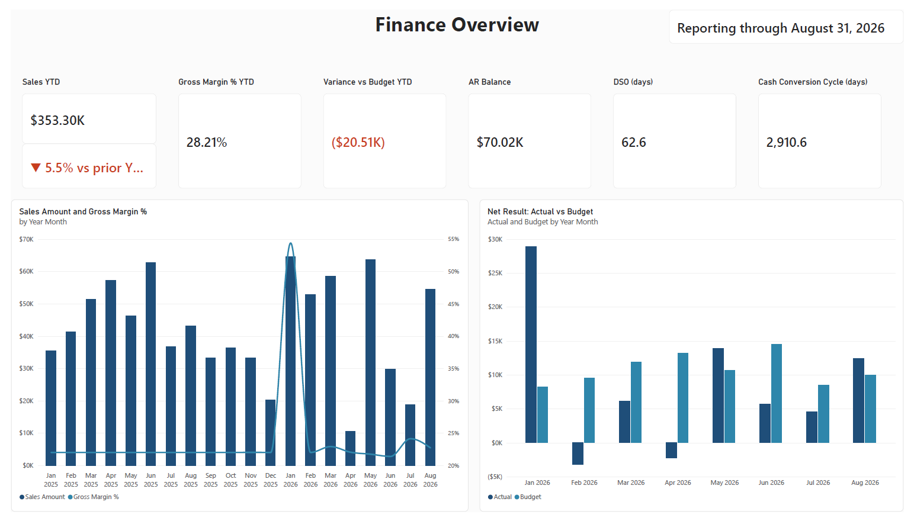
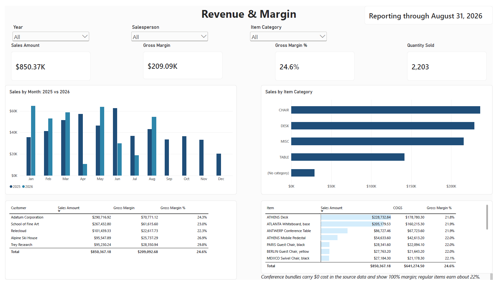
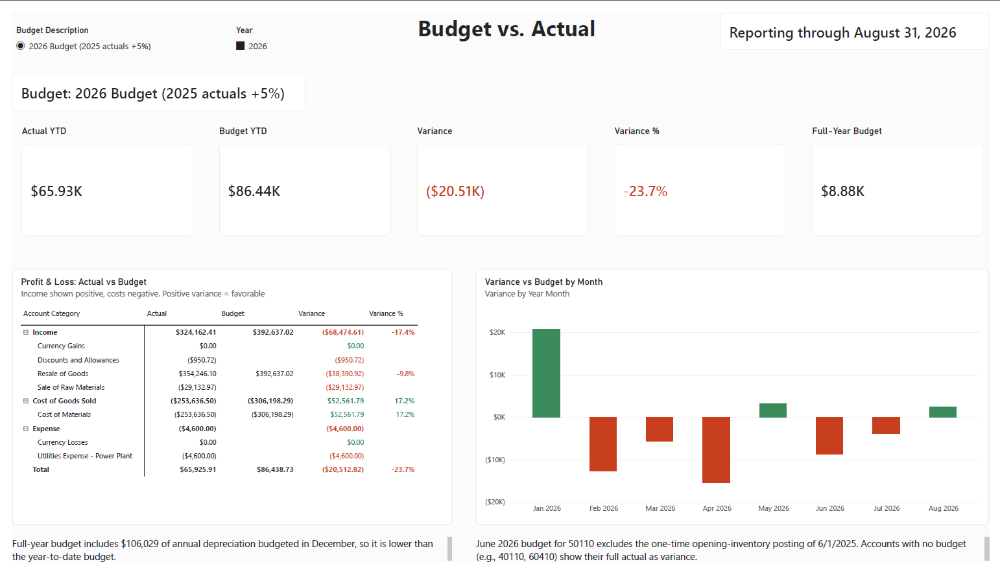
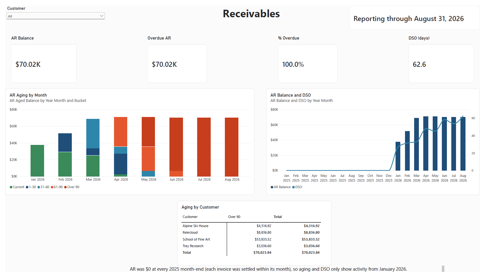
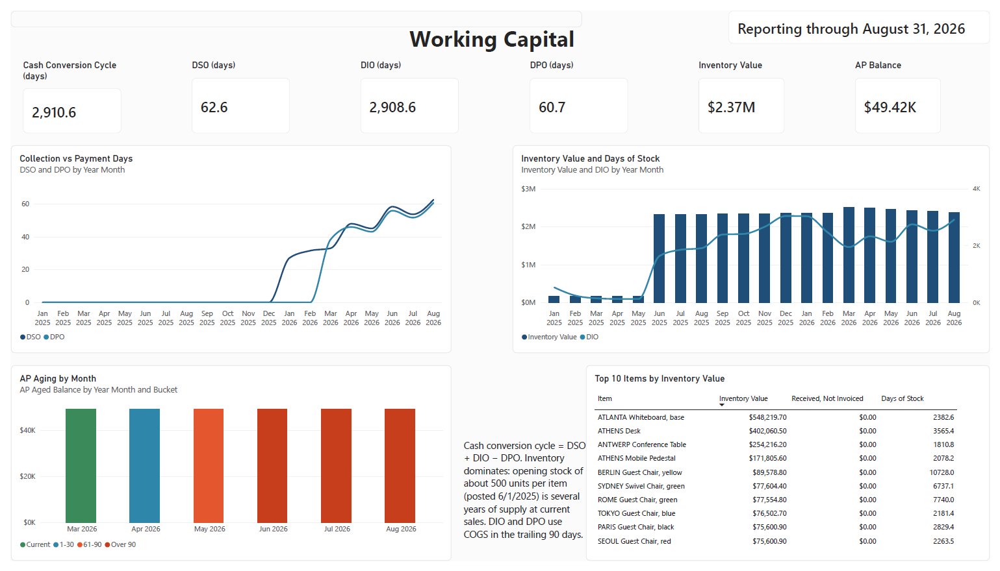
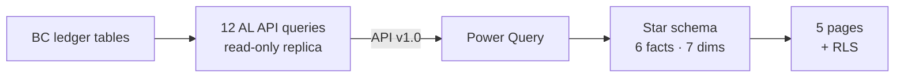

# Business Central Finance Analytics

A finance and working-capital analytics solution for **Dynamics 365 Business Central**: AL API queries expose ledger data to a **Power BI** star-schema model with five report pages, reconciled to Business Central's own reports.

> **Portfolio project.** Built on the CRONUS USA, Inc. demo company in a Business Central online sandbox (trial tenant). Figures are demo data; data quirks found along the way are documented in [docs/architecture.md](docs/architecture.md). A full PDF export of the report is available in [docs/FinanceAnalytics.pdf](docs/FinanceAnalytics.pdf).



## What it does

| Page | Answers |
|---|---|
| **Executive Overview** | Are we on track? Sales YTD vs prior year, margin, variance vs budget, AR, DSO, cash conversion cycle |
| **Revenue & Margin** | Where do revenue and margin come from (month, category, customer, salesperson)? |
| **Budget vs. Actual** | P&L by account against a selectable budget, closed months only |
| **Receivables** | What are we owed, how late is it, and is collection improving? Historical aging at every month-end |
| **Working Capital** | DSO, DIO, DPO and the cash conversion cycle; AP aging; inventory and days of stock |


## Report pages

| Revenue & Margin | Budget vs. Actual |
|---|---|
|  |  |
| **Receivables** | **Working Capital** |
|  |  |

A full PDF export of the report is available in [docs/FinanceAnalytics.pdf](docs/FinanceAnalytics.pdf).

## Architecture



**Why AL API queries instead of UI pages or OData web services:** the queries join and filter inside Business Central, run on the read-only replica, and give Power BI a stable, versioned contract (`/api/issakamo/financeAnalytics/v1.0`). Each query is covered by one least-privilege permission set, `FNX FINANCE API`.

## Data model

| Facts | Grain | Source |
|---|---|---|
| Fact Sales | Value entry (sales) | Value Entry |
| Fact GL Actual | G/L entry (income statement accounts) | G/L Entry joined to G/L Account |
| Fact GL Budget | Budget entry | G/L Budget Entry |
| Fact AR Detail | Detailed customer ledger entry | Detailed Cust. Ledg. Entry joined to Cust. Ledger Entry |
| Fact AP Detail | Detailed vendor ledger entry | Detailed Vendor Ledg. Entry joined to Vendor Ledger Entry |
| Fact Inventory Value | Value entry (all types) | Value Entry |

Dimensions: Date (DAX), Customer, Item, Salesperson, G/L Account, Vendor, Budget, plus a disconnected Aging Bucket table for dynamic aging.

## Key design decisions

- **Historical balances, not just today's.** AR and AP balances at any date are rebuilt from detailed ledger entries using the same rule as Business Central's `Remaining Amt. (LCY)` FlowField, including `Excluded from calculation = false`.
- **One reporting cutoff.** Every page stops at the last closed month (the month before the latest sale), so no partial month is compared against a full budget month.
- **Consistent working-capital ratios.** DSO uses tax-inclusive credit sales from the AR ledger; DIO and DPO use trailing 90-day COGS.
- **Budget guard.** Budget measures require exactly one selected budget, so a second budget can never be double-counted.
- **Security.** Finance role sees everything; Sales role sees its own sales and invoices, with explanatory notes on finance-only pages.

Full reasoning and data findings: [docs/architecture.md](docs/architecture.md).

## Reconciliation to Business Central

Every area was checked against Business Central before building the next one. A hidden **Reconciliation** page in the report keeps these checks.

| Check | Business Central source | Result |
|---|---|---|
| Sales, all value entries | Value Entries (Sale), Analysis mode | 526 rows, $857,299.18 ✓ |
| Sales, Jan 2025–Aug 2026 | Customers, Sales ($) with Date Filter | $850,367.18 ✓ |
| Sales, Jan–Aug 2025 (prior-year YTD) | Customers, Sales ($) with Date Filter | $373,940.00 ✓ |
| G/L to sub-ledger (2026) | G/L 40140 + 40910 vs Value Entries | $360,227.38 ✓ |
| AR as of 03/31/26 and 08/31/26 | Customer Ledger Entries, Remaining Amt. with Date Filter | $68,701.77 and $70,023.84 ✓ |
| AR aging as of 03/31/26 and 08/31/26 | Aged Accounts Receivable report | all buckets ✓ |
| AP as of 03/31/26, aging as of 08/31/26 | Vendor Ledger Entries; Aged Accounts Payable report | $49,421.55 ✓ |
| Inventory as of 08/31/26 | Inventory Valuation report | $2,368,311.00 ✓ |

## Repository structure

```
app.json                          AL extension manifest (runtime 18.0, BC 29)
AppSourceCop.json                 Mandatory affix: FNX
.al-code-analysis/ruleset.json    Documented suppressions (AS0084, AS0092)
src/Queries/                      12 API queries (53100-53111)
src/Permissions/                  FNX FINANCE API permission set
powerbi/FinanceAnalytics.pbip     Power BI project (report + TMDL semantic model)
powerbi/FinanceAnalytics.theme.json
docs/architecture.md              Design decisions and data findings
docs/screenshots/                 Report page images
```

## How to run it

1. **Business Central:** a Business Central online sandbox with the CRONUS USA, Inc. company, and a user with a Business Central license.
2. **Publish the extension:** open the folder in VS Code with the AL Language extension (v18 or later), update `launch.json` with your tenant and sandbox name, download symbols, and publish (`Ctrl+F5`).
3. **Permissions:** assign the `FNX FINANCE API` permission set to each report user.
4. **Power BI:** open `powerbi/FinanceAnalytics.pbip` in Power BI Desktop. In Power Query, update each query's `Source` step to your environment and company, then refresh. Sign in with an organizational account in the same tenant as the sandbox.

## Tech stack

AL (Business Central 2026 release wave 2, runtime 18.0) · Business Central API queries · Power Query (M) · DAX · Power BI Desktop (PBIP/TMDL) · Git

## Author

**Issaka Mohammed** · Dynamics 365 Business Central Developer (MB-820) and Functional Consultant (MB-800)
